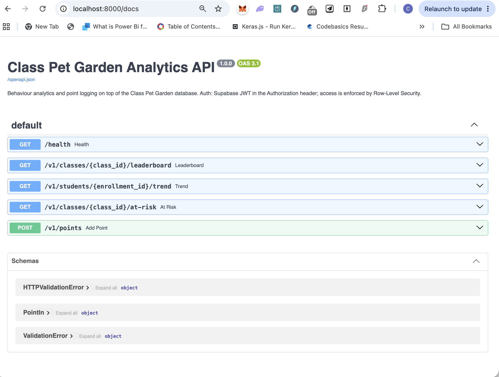

# Class Pet Garden Analytics API

[](https://github.com/BensonAnalyst/class-pet-api/actions/workflows/ci.yml)

A small **FastAPI** REST service on top of the [Class Pet Garden](https://github.com/BensonAnalyst/class-pet-garden) database. It adds behaviour analytics and an early-warning endpoint that the browser app did not have, as a documented, tested, containerised API.



## Before vs After

| | Before | After |
|---|---|---|
| Analytics | Teacher eyeballs points | Leaderboard, daily trend and an at-risk flag via API |
| Reuse | Logic only inside `index.html` | Any client (script, BI tool, another app) can call the same endpoints |
| Validation | Front end only | Server-side: label length, points limited to -10 to +10 |
| Quality | No tests | 7 unit tests, GitHub Actions CI, Docker image build |

*Pilot stage: no measured usage numbers yet.*

## Endpoints (interactive docs at `/docs`)

| Method | Path | Purpose |
|---|---|---|
| GET | `/health` | Liveness check |
| GET | `/v1/classes/{class_id}/leaderboard?limit=10` | Total points per student |
| GET | `/v1/students/{enrollment_id}/trend?days=30` | Daily net points, zero-filled |
| GET | `/v1/classes/{class_id}/at-risk?window_days=14` | Early-warning flags with reasons |
| POST | `/v1/points` | Log a point (validated, -10 to +10) |

## Security design

The caller's Supabase login token (JWT) is forwarded to Supabase, so **Row-Level Security decides what each teacher can read or write**. The service-role key is never used or stored.

## Verified against a live Supabase project

Tested with a test class of 20 students. The API and the app agree on every total.

```bash
curl -s "localhost:8000/v1/classes/$CLASS_ID/leaderboard?limit=3" -H "Authorization: Bearer $TOKEN"
```
```json
[{"name": "Muhammad Haziq", "total_points": 102},
 {"name": "Nurul Iman",     "total_points": 23},
 {"name": "Siti Aisyah",    "total_points": 5}]
```

Without a token the same call returns **HTTP 401**. A token for an account with no classes returns an empty list, because Row-Level Security hides other teachers' data.

**Bugs found while testing on real data:**
- Supabase timestamps have a variable number of fractional digits, which Python 3.10 cannot parse. Fixed with a normalising parser and a regression test.
- The browser app's Daily Check-in points were saved only in local storage, so the API totals were 2 points lower than the app. Fixed by syncing check-ins to the database.

## Run it

```bash
export SUPABASE_URL=https://<project>.supabase.co
export SUPABASE_ANON_KEY=<publishable key>
pip install -r requirements.txt
uvicorn app.main:app --reload      # http://localhost:8000/docs
pytest -q
docker build -t class-pet-api . && docker run -p 8000:8000 -e SUPABASE_URL -e SUPABASE_ANON_KEY class-pet-api
```

## Known limitations

- The at-risk rule flags **sustained** declines (negative net points over the window, or a drop more than 2 standard deviations below the class). A single bad day will not trigger it, and a brand-new class has no history to compare against.
- Same-day check-in corrections update the browser only; the first save each day is what syncs.
- Not deployed publicly yet: runs locally and in Docker.
